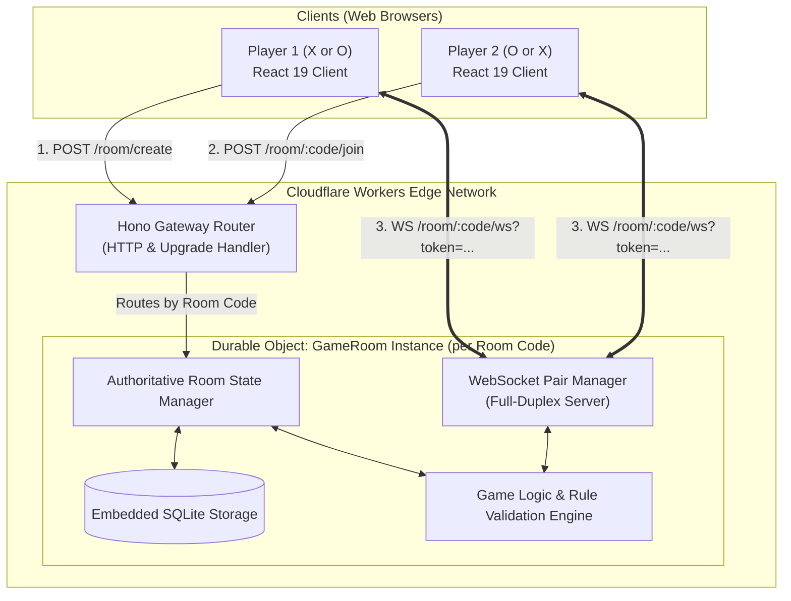

# 🎮 Full-Stack Real-Time Multiplayer Tic-Tac-Toe

A modern, high-performance, real-time multiplayer Tic-Tac-Toe game built with a serverless edge architecture. Powered by **Cloudflare Workers**, **Cloudflare Durable Objects**, **Hono**, **React 19**, and **Tailwind CSS v4**.

---

## 📑 Table of Contents

- [Overview](#-overview)
- [Architecture & System Design](#-architecture--system-design)
  - [High-Level System Architecture](#high-level-system-architecture)
  - [Backend Architecture (Cloudflare Edge & Durable Objects)](#backend-architecture)
  - [Frontend Architecture (React 19 & Tailwind CSS v4)](#frontend-architecture)
- [Core Features](#-core-features)
- [UI / UX Design & Pages](#-ui--ux-design--pages)
  - [Design Language & Theme](#design-language--theme)
  - [Home View (`/`)](#home-view-)
  - [Game View (`/game`)](#game-view-game)
  - [Modal Dialogs & Micro-interactions](#modal-dialogs--micro-interactions)
- [API & WebSocket Protocol](#-api--websocket-protocol)
  - [HTTP REST Endpoints](#http-rest-endpoints)
  - [WebSocket Protocol & Event Flow](#websocket-protocol--event-flow)
- [Project Directory Structure](#-project-directory-structure)
- [Getting Started](#-getting-started)
  - [Prerequisites](#prerequisites)
  - [Backend Setup](#backend-setup)
  - [Frontend Setup](#frontend-setup)
- [Deployment Guide](#-deployment-guide)
- [Technologies Used](#-technologies-used)
- [Future Enhancements](#-future-enhancements)

---

## 🌟 Overview

This project is a distributed, full-duplex multiplayer Tic-Tac-Toe application. Rather than relying on traditional monolithic backend servers with long-running polling or third-party socket services, it leverages **Cloudflare Durable Objects** to create globally coordinated, stateful micro-rooms right at the network edge.

Each room operates as an isolated actor that maintains authoritative state, persists game boards to SQLite storage, and manages direct WebSocket connections to both players with ultra-low latency.

---

## 🏗️ Architecture & System Design

### High-Level System Architecture



---

### Backend Architecture

The backend is built with **Hono** running on the **Cloudflare Workers** runtime, coordinating with **Cloudflare Durable Objects**.

1. **Edge Router (`src/routes/room.ts` & `src/controllers/room.controller.ts`)**:
   - Handles REST calls to generate rooms and issue tokens.
   - Upgrades incoming HTTP connections into persistent WebSocket connections directly routed to the corresponding room's Durable Object.
2. **Authoritative Durable Object (`src/durable-objects/game-room.ts`)**:
   - Each active 6-character room code addresses an isolated, stateful `GameRoom` actor (`env.GAME_ROOM.idFromName(code)`).
   - Manages player concurrency, ensuring exactly two players enter a match and preventing unauthorized spectator actions.
   - Holds active `WebSocket` connections in an in-memory connection map (`Map<Player, WebSocket>`).
   - Persists room data with `ctx.storage.put("room", this.roomState)` backed by Cloudflare's Durable Object SQLite engine.
3. **Game Rule Engine (`src/services/game.service.ts`)**:
   - Validates turn order (`gameState.turn === player`).
   - Checks move bounds ($0 \le position \le 8$) and guarantees unoccupied cell placement.
   - Determines victory by validating all 8 winning combinations (3 horizontal, 3 vertical, 2 diagonal).
   - Handles stalemate/draw conditions when all 9 squares are populated without a winner.
4. **Room Lifecycle Service (`src/services/room.service.ts`)**:
   - Assigns random starting symbols (`X` or `O`) to the creator.
   - Issues cryptographically secure session tokens (`crypto.randomUUID()`) to prevent session spoofing.

---

### Frontend Architecture

The frontend is a single-page React 19 application bundled with **Vite** and styled with **Tailwind CSS v4**.

- **Routing (`src/App.tsx`)**: Built using `react-router` (v7) with two primary views:
  - `/` (Home landing page, room creation & joining modals)
  - `/game` (Game arena, interactive board, dynamic turn banners, end-game modals)
- **Real-Time Client (`src/pages/Game.tsx`)**:
  - Connects to the backend via native browser WebSockets (`new WebSocket(...)`).
  - Manages reactive state for board updates, player assignment, active turns, and modal popups.
  - Automatically manages connection teardown when navigating away or unmounting.
- **State Synchronization & Persistence**:
  - Game session tokens (`playerToken`) and active room identifiers (`roomCode`) are stored in `localStorage` for automatic reconnection support.
- **Feedback & Notifications**:
  - `sonner` Toaster system displays notifications on invalid inputs, connection faults, or unauthorized moves.

---

## ⚡ Core Features

- 🌐 **Instant Room Creation**: Generates random, unique 6-character alphanumeric room codes (e.g., `AB12CD`).
- 👥 **Dynamic Player Assignment**: Randomly designates either `X` or `O` to Player 1; Player 2 automatically receives the complementary marker.
- 🔐 **Token-Based Player Authentication**: Each player gets a secure UUID token upon room creation or join, preventing token spoofing or foreign move injections.
- ⚡ **Low-Latency Full-Duplex WebSockets**: Real-time board replication and move broadcasts powered by Cloudflare `WebSocketPair`.
- 🛡️ **Authoritative Server Validation**: Board positions, turn validity, active status, and win/draw evaluations are executed strictly on the server to eliminate client-side tampering.
- 💾 **SQLite Persistence on the Edge**: Game state survives temporary network hiccups via Durable Object SQLite storage.
- 🎨 **Minimalist High-Contrast UI**: Clean, distraction-free monochrome aesthetic with fluid transitions and responsive mobile/desktop scaling.
- 🔄 **Rejoin & Refresh Handling**: Players with a valid token can re-enter their ongoing match seamlessly.

---

## 🖥️ UI / UX Design & Pages

### Design Language & Theme

- **Palette**: Dark/Monochrome theme (`#000000` pitch black background, pure `#FFFFFF` primary elements, `#181818` card surfaces, `#303030` buttons with `#494949` borders).
- **Typography**: Bold, high-contrast display headings (`text-5xl md:text-7xl`).
- **Interactive Feedback**: Scale transitions on hover and click (`hover:scale-105 active:scale-95`) with smooth transition curves.
- **Glassmorphism**: Modals feature dark translucent backdrops (`bg-black/50`) and glass blur styling (`backdrop-blur-3xl`).

---

### Home View (`/`)

The entry portal of the application:
1. **Title**: Prominent `TIC TAC TOE` header.
2. **Action Buttons**:
   - **"Create a Room"**: Fires `POST /room/create`, retrieves a 6-character room code & player token, stores credentials locally, and redirects to `/game`.
   - **"Join a Room"**: Triggers an interactive modal prompting for a 6-digit room code. Validates length and auto-capitalizes input before executing `POST /room/:code/join`.

```
+------------------------------------------+
|                                          |
|               TIC TAC TOE                |
|                                          |
|           [  Create a Room  ]            |
|                                          |
|            -------- or --------          |
|                                          |
|           [   Join a Room   ]            |
|                                          |
+------------------------------------------+
```

---

### Game View (`/game`)

The active gameplay view:
1. **Status Header**:
   - Dynamically displays `Your Turn` when it is the local player's turn.
   - Displays `Opponent's Turn` when awaiting the other player's move.
2. **Authoritative 3x3 Grid (`Board.tsx` & `Cell.tsx`)**:
   - 9 interactive, rounded cell buttons (`rounded-2xl`).
   - Dynamically populated with large `X` or `O` glyphs (`text-3xl md:text-6xl`).
   - Clicking an empty square sends a WebSocket `move` payload to the server.
3. **Waiting Modal**:
   - When only one player is present (`status: "waiting"`), a modal displays the room code with the prompt:
     > **"The code is: <ROOM_CODE>"**  
     > *Waiting for other player to join...*
4. **Game Finished Modal**:
   - Displays the outcome:
     - 🏆 `You Won!`
     - ❌ `Your Opponent Won.`
     - 🤝 `It's a Draw`
   - Actions to `Play again` or `Exit`.

```
+------------------------------------------+
|                Your Turn                 |
|                                          |
|             +---+---+---+                |
|             | X |   | O |                |
|             +---+---+---+                |
|             |   | X |   |                |
|             +---+---+---+                |
|             | O |   | X |                |
|             +---+---+---+                |
|                                          |
+------------------------------------------+
```

---

### Modal Dialogs & Micro-interactions

| Modal State | Trigger | Appearance & Content |
|---|---|---|
| **Room Creation Loading** | User clicks "Create a Room" | Centered spinner with `Loading...` indicator |
| **Join Room Input** | User clicks "Join a Room" | Input text box for 6-character room code + "Join" button |
| **Waiting for Opponent** | Game initialized, player count = 1 | Displays bold Room Code and waiting message |
| **Game Over** | Game finishes (Win, Loss, or Draw) | Displays game outcome and options to rematch or exit |

---

## 📡 API & WebSocket Protocol

### HTTP REST Endpoints

Base URL: `http://localhost:8787` (local dev) or production worker domain.

#### 1. Create Room
- **Method**: `POST`
- **Route**: `/room/create`
- **Response** `(200 OK)`:
  ```json
  {
    "roomCode": "K7X9B2",
    "token": "3f8489e2-63db-4cb6-a67b-117d91fbbcf0",
    "player": "X"
  }
  ```

#### 2. Join Room
- **Method**: `POST`
- **Route**: `/room/:code/join`
- **URL Parameters**: `code` (string, exactly 6 alphanumeric characters)
- **Response** `(200 OK)`:
  ```json
  {
    "token": "7a942bc1-19d2-43bb-a178-9e63f91572c1",
    "player": "O"
  }
  ```
- **Error Responses**:
  - `400 Bad Request`: `{"error": "Invalid code"}` or `{"error": "Room is full"}`

---

### WebSocket Protocol & Event Flow

#### Connection Handshake
- **URL**: `ws://localhost:8787/room/:code/ws?token=<PLAYER_TOKEN>`
- **Headers**: `Upgrade: websocket`

#### Server-to-Client Messages

1. **`player_assigned`** (sent immediately upon connection):
   ```json
   {
     "type": "player_assigned",
     "player": "X"
   }
   ```
2. **`game_status`** (sent upon connection and after every valid move):
   ```json
   {
     "type": "game_status",
     "game": {
       "board": ["X", null, null, null, "O", null, null, null, null],
       "turn": "X",
       "winner": null,
       "status": "playing"
     }
   }
   ```
3. **`player_disconnected`** (sent when an opponent closes their socket):
   ```json
   {
     "type": "player_disconnected",
     "player": "O"
   }
   ```
4. **`error`** (sent on illegal moves or malformed payloads):
   ```json
   {
     "type": "error",
     "message": "It's not your turn"
   }
   ```

#### Client-to-Server Messages

1. **`move`** (submits a move for a specific cell index `0` to `8`):
   ```json
   {
     "type": "move",
     "position": 4
   }
   ```

---

## 📁 Project Directory Structure

```plaintext
Tic-Tac-Toe/
├── README.md                      # Comprehensive project documentation
│
├── backend/                       # Cloudflare Workers & Durable Objects backend
│   ├── src/
│   │   ├── controllers/
│   │   │   └── room.controller.ts # Route controller dispatching to Durable Objects
│   │   ├── durable-objects/
│   │   │   └── game-room.ts       # Durable Object actor class & WebSocket broker
│   │   ├── routes/
│   │   │   └── room.ts            # Hono routing definitions
│   │   ├── services/
│   │   │   ├── game.service.ts    # Tic-Tac-Toe game rules, move & win evaluation
│   │   │   └── room.service.ts    # Player assignment & room creation logic
│   │   ├── types/
│   │   │   └── game.ts            # Shared TypeScript types for game state
│   │   ├── utils/
│   │   │   └── generate-code.ts   # 6-character room code generator
│   │   └── index.ts               # Cloudflare Worker entry point
│   ├── package.json               # Backend dependencies (Hono, Wrangler)
│   ├── tsconfig.json              # TypeScript compiler configuration
│   └── wrangler.jsonc             # Cloudflare Workers & Durable Objects bindings config
│
└── frontend/                      # React 19 + Vite frontend
    ├── src/
    │   ├── components/
    │   │   ├── Board.tsx          # 3x3 Grid component
    │   │   ├── Cell.tsx           # Individual board square with micro-interactions
    │   │   └── Modal.tsx          # Reusable glassmorphic backdrop modal
    │   ├── pages/
    │   │   ├── Game.tsx           # Real-time WebSocket game arena page
    │   │   └── Home.tsx           # Landing page with Create/Join room flows
    │   ├── types/
    │   │   └── game.ts            # Frontend TypeScript game interfaces
    │   ├── App.tsx                # Main router setup & Sonner toast container
    │   ├── index.css              # Global styles & Tailwind CSS v4 import
    │   └── main.tsx               # React root mount
    ├── eslint.config.js           # ESLint configuration
    ├── index.html                 # HTML template
    ├── package.json               # Frontend dependencies (React 19, Tailwind v4, Vite)
    ├── tsconfig.json              # TypeScript root config
    └── vite.config.ts             # Vite configuration with Tailwind CSS plugin
```

---

## 🚀 Getting Started

### Prerequisites

Ensure you have the following installed on your machine:
- [Node.js](https://nodejs.org/) (version `18.x` or later recommended)
- `npm` or `pnpm`
- Cloudflare [Wrangler CLI](https://developers.cloudflare.com/workers/wrangler/) (installed automatically via `devDependencies`)

---

### Backend Setup

1. **Navigate to the backend directory**:
   ```bash
   cd backend
   ```

2. **Install dependencies**:
   ```bash
   npm install
   ```

3. **Start the local development server**:
   ```bash
   npm run dev
   ```
   *The backend will boot up locally with Miniflare running on `http://localhost:8787`.*

4. *(Optional) Generate Worker type definitions*:
   ```bash
   npm run cf-typegen
   ```

---

### Frontend Setup

1. **Navigate to the frontend directory** in a new terminal window:
   ```bash
   cd frontend
   ```

2. **Install dependencies**:
   ```bash
   npm install
   ```

3. **Start Vite development server**:
   ```bash
   npm run dev
   ```
   *The frontend will start on `http://localhost:5173`.*

4. **Play the Game**:
   - Open two separate browser tabs at `http://localhost:5173`.
   - In Tab 1: Click **"Create a Room"**.
   - Copy the 6-character room code shown in Tab 1's waiting modal.
   - In Tab 2: Click **"Join a Room"**, enter the 6-character room code, and click **"Join"**.
   - Both tabs will instantly sync into the match!

---

## 🚢 Deployment Guide

### Deploy Backend to Cloudflare Workers

1. Log in to your Cloudflare account via Wrangler:
   ```bash
   cd backend
   npx wrangler login
   ```
2. Deploy the Worker and Durable Objects:
   ```bash
   npm run deploy
   ```
3. Update the frontend API endpoint (`http://localhost:8787`) to point to your live Worker URL (e.g., `https://backend.<your-subdomain>.workers.dev`).

### Deploy Frontend to Cloudflare Pages / Vercel / Netlify

1. Build the production assets:
   ```bash
   cd frontend
   npm run build
   ```
2. The optimized output is written to `frontend/dist/`, ready to be deployed to any static host (Cloudflare Pages, Vercel, Netlify, or GitHub Pages).

---

## 🛠️ Technologies Used

| Layer | Technology | Purpose |
|---|---|---|
| **Runtime & Edge** | [Cloudflare Workers](https://workers.cloudflare.com/) | Low-latency serverless edge computing |
| **State & Coordination** | [Cloudflare Durable Objects](https://developers.cloudflare.com/durable-objects/) | Strongly consistent, isolated actor state & native WebSockets |
| **Edge Storage** | Durable Object SQLite | Persistent game and room session state |
| **Backend Framework** | [Hono](https://hono.dev/) | Ultrafast, lightweight web framework designed for edge runtimes |
| **Frontend Framework** | [React 19](https://react.dev/) | Component architecture & stateful client rendering |
| **Build Tooling** | [Vite](https://vite.dev/) | Instant hot-module replacement and rapid bundling |
| **Styling** | [Tailwind CSS v4](https://tailwindcss.com/) | Modern utility-first CSS styling |
| **Routing** | [React Router v7](https://reactrouter.com/) | Declarative client-side routing |
| **HTTP Client** | [Axios](https://axios-http.com/) | Clean REST API communication |
| **Toast Notifications** | [Sonner](https://sonner.emilkowal.ski/) | Elegant stackable dark toast notifications |
| **Language** | [TypeScript](https://www.typescriptlang.org/) | Full-stack end-to-end type safety |

---

## 💡 Future Enhancements

- [ ] **Configurable Turn Timers**: Introduce chess-clock style countdown timers for each move.
- [ ] **Rematch Protocol**: Live rematch acceptance flow without needing to generate a new room.
- [ ] **Spectator Mode**: Allow additional players beyond two to watch matches in real-time.
- [ ] **Player Profiles & Nicknames**: Allow custom player avatars and display handles.
- [ ] **Leaderboards & Match History**: Persist player score counters across sessions.

---

## 📄 License

This project is licensed under the [MIT License](LICENSE).
